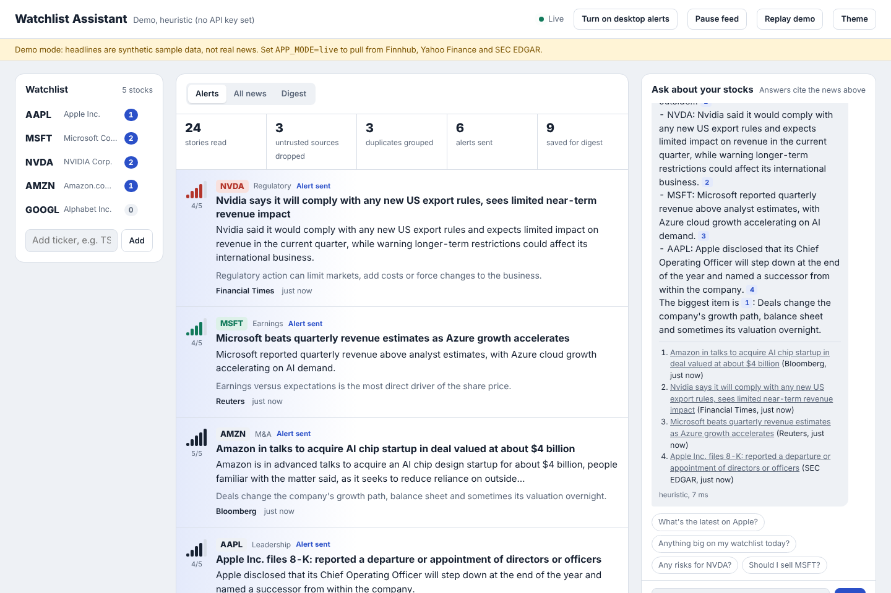
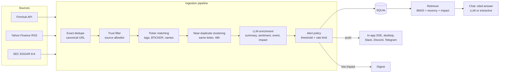

# Watchlist Assistant

A proof of concept of an AI assistant for a stock watchlist. When a **trusted source** publishes news about a stock you follow, you get **one** alert that says what happened and why it matters. A chat assistant answers questions about your stocks, citing those same news items.

Built by [Bala Ajay Kumar Reddy Gali](https://github.com/gali-ai-engineer) as a working PoC.



## What it does

| | |
|---|---|
| **Watchlist alerts** | Polls news for each ticker, keeps only trusted outlets, groups the same story from several outlets into one item, scores it with an LLM and pushes it to the browser, desktop, Slack, Discord or Telegram. |
| **Noise control** | Only high-impact news (earnings surprises, M&A, regulatory action, leadership changes) interrupts you. Everything else goes to a digest. Each ticker is rate-limited so a busy news day doesn't flood your phone. |
| **Chat** | Answers questions over your own news feed using retrieval (BM25, re-ranked for recency and impact). Every claim is cited as [n] with a link to the source. It explains the news but doesn't give buy or sell calls. |
| **Runs anywhere** | Works offline out of the box: demo mode replays sample news and uses heuristics instead of an LLM. Add API keys to switch to live sources and a real model. |

## Quick start

```bash
git clone https://github.com/gali-ai-engineer/watchlist-assistant
cd watchlist-assistant
python -m venv .venv && source .venv/bin/activate
pip install -r requirements.txt
uvicorn app.main:app --reload
# open http://localhost:8000
```

That's it: no keys needed. You'll see demo stories arrive every few seconds.

**Use a real LLM:** copy `.env.example` to `.env` and set any one of `OPENAI_API_KEY`, `ANTHROPIC_API_KEY` or `GEMINI_API_KEY`. The provider is picked automatically, or you can force one with `LLM_PROVIDER`.

**Use live news:** set `APP_MODE=live`. Yahoo Finance RSS and SEC EDGAR need no key. Add a free `FINNHUB_API_KEY` for wider coverage, and set `SEC_USER_AGENT` to your name and email (the SEC requires it).

**Docker:** `docker build -t watchlist-assistant . && docker run -p 8000:8000 --env-file .env watchlist-assistant`

**Tests:** `python -m unittest discover -s tests -t .` (or `pytest`). There are 48 tests and none of them touch the network.

> Demo-mode headlines in `data/demo_news.json` are **synthetic**: invented to exercise the pipeline, not real news. The UI shows a banner whenever it is running on them.

## Architecture



Each stage counts what it drops, and the UI shows that as a funnel: stories read, untrusted sources dropped, duplicates grouped, alerts sent, saved for digest. That shows the system is filtering, not just forwarding.

### Design decisions

- **The hard problem is noise, not fetching.** One earnings release appears on 5 to 10 sites within minutes. Exact URL dedupe isn't enough, so near-duplicates are clustered. Text is normalized for synonyms ("probe" and "investigation", "EU" and "European Commission"), the headline and the opening paragraph are compared, and only stories about the same ticker within 48 hours are candidates. On the sample data, true duplicates score 0.57 or higher and different stories 0.27 or lower, so the threshold sits at 0.45. Follow-up stories with new information (Nvidia's response to export curbs) are correctly kept as new items.
- **Credibility is explicit.** `app/trust.py` scores sources from 0 to 1. Primary sources (SEC filings) rank highest, then newswires and the tier-1 financial press. Tip sites and rumour blogs never alert. Compliance or editorial teams can own this list.
- **The LLM is a component, not a dependency.** Enrichment is one structured-output call per article. The output is validated and clamped (sentiment within -1 to 1, impact within 1 to 5, event type from a fixed set). If the model call fails, the keyword heuristic takes over, so an LLM outage never stops alerts. Providers are called over plain REST, so switching between OpenAI, Anthropic and Gemini is a config change.
- **Prompt-injection aware.** News text is untrusted input. Both prompts tell the model to treat it strictly as data, and the UI escapes everything it renders.
- **Grounded chat.** The model sees only the retrieved, numbered items and must cite them. The response only includes sources the answer actually cited. Requests for buy or sell advice get the relevant news instead of a recommendation.
- **Built to evolve.** `Pipeline.run_once()` is synchronous and only writes to the store, so it can move into a queue worker without changes. Sources, notifiers and LLM providers are small interfaces.

## Project layout

```
app/
  main.py         HTTP API, server-sent events, background polling loop
  pipeline.py     fetch → dedupe → trust → match → cluster → enrich → alert
  sources.py      Finnhub, Yahoo RSS, SEC EDGAR (8-K items in plain English), demo replay
  trust.py        source credibility scores
  dedupe.py       canonical URLs, near-duplicate clustering
  matcher.py      article → watchlist tickers
  enrich.py       LLM enrichment + heuristic fallback
  alerts.py       push vs digest policy, per-ticker rate limit
  rag.py          BM25 retrieval + cited chat answers
  llm.py          OpenAI / Anthropic / Gemini over REST
  notifiers.py    SSE broadcaster, Slack, Discord, Telegram
  storage.py      SQLite
  static/index.html   single-page UI (no build step)
data/demo_news.json   synthetic sample news for offline demo
tests/                pipeline, API and connector tests (network mocked)
```

## API

| Method | Path | Purpose |
|---|---|---|
| GET | `/api/watchlist` | List tickers |
| POST | `/api/watchlist` `{"ticker":"TSLA"}` | Add a ticker and backfill its recent news |
| DELETE | `/api/watchlist/{ticker}` | Remove a ticker |
| GET | `/api/alerts?priority=push&ticker=NVDA` | Alerts with article and enrichment |
| POST | `/api/alerts/{id}/read` | Mark read |
| GET | `/api/digest` | Lower-impact items grouped by ticker |
| POST | `/api/chat` `{"question":"...","history":[...]}` | Cited answer |
| GET | `/api/stream` | Server-sent events: `alert`, `metrics` |
| GET | `/api/metrics` | Pipeline counters |
| POST | `/api/refresh` | Run the pipeline now |

## Taking it to production

What I'd change, roughly in order:

1. **Multi-user.** Add auth, per-user watchlists and alert preferences (threshold, quiet hours, channels), and fan out alerts per subscriber rather than per ticker.
2. **Scale the pipeline.** A scheduler enqueues one job per ticker; workers fetch, enrich and alert. Move from SQLite to Postgres. Cache enrichment by story cluster so 10,000 users following NVDA cost one LLM call, not 10,000.
3. **Better retrieval.** Hybrid BM25 plus embeddings (pgvector), and add structured data (prices, earnings calendar, filings) as tools the chat agent can call.
4. **Delivery.** Mobile push via FCM/APNs and an email digest, with delivery receipts and retries.
5. **Quality and evaluation.** A labelled set of headlines to track precision and recall for "should this have alerted?", duplicate-clustering accuracy, and chat groundedness (every sentence supported by a cited source). Run it on every prompt or model change.
6. **Latency and cost.** Track time from publication to alert as the main metric. Use a small fast model for enrichment and a larger one only for chat. Batch enrichment calls.
7. **Compliance.** Licensed news feeds for redistribution, audit logs of what was sent to whom, and clear not-advice positioning.

## Known limitations

- Ticker and company reference data is a static map of about 15 large US stocks. Unknown tickers still match through source tags, `$TICKER` and `(NASDAQ: X)` mentions. In production this would come from a security master.
- The heuristic enrichment is keyword-based. It covers the main event types but a real LLM is noticeably better at nuance (sentiment, materiality).
- Live connectors were tested against sample payloads with the network mocked. Field formats for Finnhub, Yahoo RSS and EDGAR follow their public documentation, but the endpoints weren't called during development.
